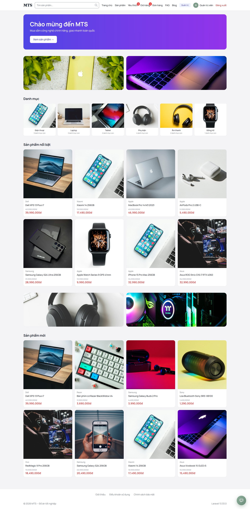
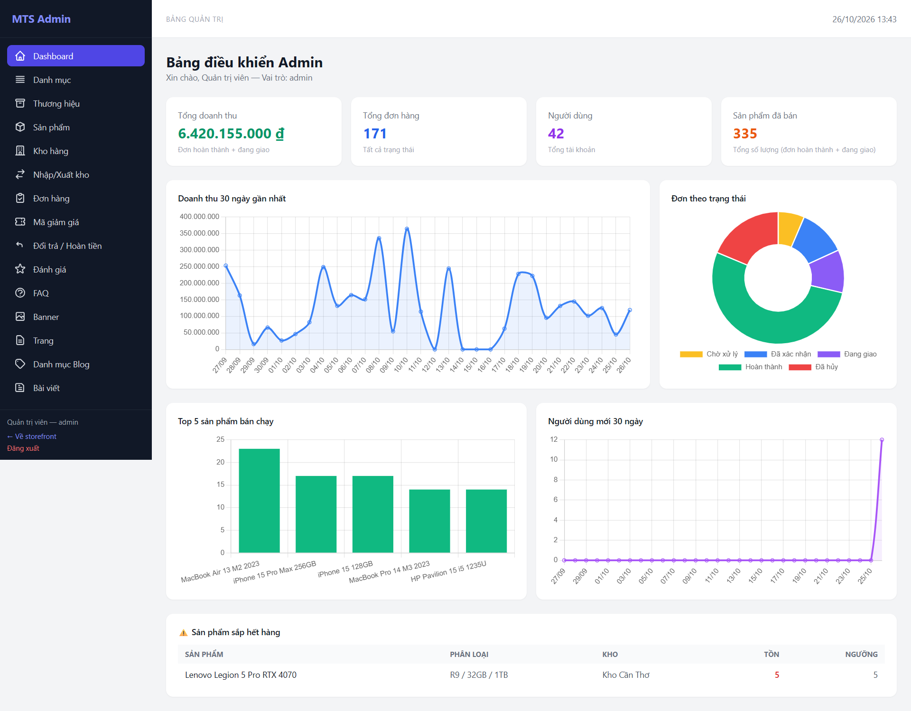

# MTS — Website thương mại điện tử bán đồ công nghệ

Website bán hàng B2C xây dựng bằng Laravel, gồm cửa hàng trực tuyến cho khách và trang quản trị cho admin/staff. Đây là đồ án cá nhân, phục vụ mục đích học tập và làm portfolio.

## Giới thiệu

Dự án mô phỏng một shop bán đồ công nghệ với đầy đủ nghiệp vụ cơ bản: quản lý danh mục sản phẩm và biến thể, theo dõi tồn kho theo nhiều kho, xử lý đơn hàng từ lúc khách đặt đến khi giao thành công, thanh toán qua COD hoặc VNPay, quản lý đổi trả, đánh giá sản phẩm và nội dung website.

Hệ thống thiết kế cho mô hình một cửa hàng duy nhất, giao diện web xây dựng bằng Blade kết hợp Tailwind CSS và Alpine.js. Toàn bộ nội dung và thông báo hiển thị bằng tiếng Việt. Thanh toán VNPay tích hợp qua môi trường sandbox để kiểm thử luồng thanh toán online trước khi kết nối tài khoản thật.

## Công nghệ sử dụng

**Backend**

- PHP >= 8.3, Laravel 13
- `spatie/laravel-permission` — phân quyền admin / staff / customer
- `barryvdh/laravel-dompdf` — xuất hóa đơn PDF
- Laravel Breeze — khung đăng nhập, đăng ký, quên mật khẩu, xác minh email
- PHPUnit 12 — kiểm thử

**Frontend**

- Blade template
- Tailwind CSS 3
- Alpine.js
- Vite

**Cơ sở dữ liệu**

- MySQL 8.4 hoặc SQLite. Giá trị mặc định trong `config/database.php` là `sqlite`; có thể đổi qua biến `DB_CONNECTION` trong `.env`.

**Dịch vụ ngoài (tùy chọn, cần khóa riêng)**

- VNPay sandbox — thanh toán online.
- Groq API — chatbot tư vấn và sinh mô tả sản phẩm trong trang admin.
- SMTP — gửi email thông báo cho khách.

## Chức năng

### Phía khách hàng

- **Trang chủ**: banner theo 3 vị trí (đầu / giữa / cuối trang), danh mục gốc, sản phẩm nổi bật và sản phẩm mới.
- **Danh sách sản phẩm**: lọc theo danh mục (gồm cả danh mục con), thương hiệu, khoảng giá; sắp xếp theo mới nhất, giá tăng/giảm, bán chạy; tìm theo tên và mô tả ngắn; phân trang.
- **Chi tiết sản phẩm**: nhiều ảnh, biến thể, giá khuyến mãi, đánh giá đang hiển thị, sản phẩm liên quan; thêm vào giỏ, quản lý yêu thích.
- **Giỏ hàng**: hỗ trợ cả khách chưa đăng nhập (lưu theo session token) lẫn người đã đăng nhập; khi đăng nhập, giỏ của khách được gộp vào giỏ tài khoản. Giá được cập nhật theo giá hiện tại khi mở giỏ.
- **Thanh toán**: chọn khu vực và phương thức vận chuyển (lọc theo giá trị đơn và cân nặng), nhập mã giảm giá, chọn COD hoặc VNPay.
- **VNPay**: tạo URL thanh toán có ký HMAC-SHA512, xử lý cả Return URL và IPN; cập nhật thanh toán theo hướng idempotent.
- **Đơn hàng**: xem danh sách và chi tiết; khách vãng lai xem được đơn đã đặt trong cùng session; hủy đơn COD đang chờ xử lý và chưa thanh toán (hoàn lại tồn kho); in hóa đơn PDF; gửi yêu cầu trả hàng khi đơn đã hoàn thành.
- **Đánh giá**: chỉ gửi được cho đơn đã hoàn thành, mỗi sản phẩm trong một đơn được đánh giá một lần; điểm trung bình của sản phẩm được tính lại sau mỗi thay đổi.
- **Email thông báo có hàng**: khách để lại email ở trang sản phẩm để đăng ký; khi tồn kho của sản phẩm (hoặc biến thể) chuyển từ 0 lên lớn hơn 0, hệ thống gửi email thông báo. Mỗi đăng ký chỉ nhận một lần.
- **Nội dung**: blog (bài đã publish, tăng lượt xem, bài liên quan), FAQ nhóm theo chủ đề, trang tĩnh hiển thị ở footer.
- **Chatbot AI**: trả lời tư vấn dựa trên danh sách sản phẩm đang bán (cần `GROQ_API_KEY`).
- **Tài khoản**: cập nhật hồ sơ, ảnh đại diện, giới tính, ngày sinh, đổi mật khẩu, xóa tài khoản.

### Phía quản trị

- **Dashboard**: doanh thu, tổng đơn, tổng người dùng, số sản phẩm đã bán; 4 biểu đồ (doanh thu 30 ngày, đơn theo trạng thái, top sản phẩm bán chạy, người dùng mới); danh sách sản phẩm sắp hết hàng.
- **Catalog**: CRUD danh mục, thương hiệu, sản phẩm và biến thể sản phẩm; upload ảnh sản phẩm.
- **Kho**: CRUD kho; nhập / xuất / điều chỉnh tồn; ghi lịch sử biến động kho; đồng bộ tồn của biến thể; tự động gửi email cho người đã đăng ký khi hàng về.
- **Đơn hàng**: lọc và tìm kiếm, xem chi tiết, cập nhật trạng thái. Khi chuyển sang "đang giao" phải chọn kho để trừ tồn; khi hủy đơn thì hoàn kho. Admin cập nhật được trạng thái thanh toán; có thể in hóa đơn.
- **Mã giảm giá**: CRUD và xem lịch sử lượt dùng.
- **Đổi trả**: duyệt, từ chối, đánh dấu đã hoàn tiền.
- **Đánh giá**: ẩn/hiện đánh giá.
- **Nội dung**: CRUD banner, FAQ, trang tĩnh, danh mục blog, bài viết.
- **AI**: nút "Viết bằng AI" trong form sản phẩm để sinh mô tả (gọi Groq).

Phân quyền: `admin` có toàn quyền; `staff` giới hạn ở một số quyền sản phẩm và đơn hàng (xem/cập nhật), không truy cập dashboard, không đổi trạng thái thanh toán.

## Yêu cầu môi trường

- PHP >= 8.3 kèm các extension thông thường của Laravel (mbstring, pdo, openssl, ...)
- Composer 2
- Node.js 20 trở lên (khuyến nghị bản LTS mới nhất)
- MySQL 8.x hoặc SQLite
- (Tùy chọn) Docker nếu chạy bằng Laravel Sail — repo có sẵn `compose.yaml`

## Cài đặt và chạy

### Cách 1: chạy trực tiếp trên máy

```bash
# 1. Cài dependency PHP
composer install

# 2. Tạo file môi trường
cp .env.example .env
php artisan key:generate
```

Chọn database:

- **SQLite** (nhanh, không cần cài server):
    ```bash
    touch database/database.sqlite
    ```
    Trong `.env`:
    ```
    DB_CONNECTION=sqlite
    ```
- **MySQL**: tạo database rỗng, sau đó trong `.env`:
    ```
    DB_CONNECTION=mysql
    DB_HOST=127.0.0.1
    DB_PORT=3306
    DB_DATABASE=ten_database
    DB_USERNAME=...
    DB_PASSWORD=...
    ```

Tiếp tục:

```bash
# 3. Tạo bảng
php artisan migrate

# 4. Nạp dữ liệu mẫu (khuyến nghị để có dữ liệu xem thử)
php artisan db:seed

# 5. Link thư mục upload công khai
php artisan storage:link

# 6. Cài và build frontend
npm install
npm run build     # hoặc npm run dev khi đang phát triển

# 7. Chạy server
php artisan serve
```

Mở `http://127.0.0.1:8000`.

Repo có script `composer setup` gộp một phần các bước trên (cài dependency, tạo `.env`, generate key, migrate, build frontend). Script này chạy `migrate --force` nên chỉ dùng khi đã hiểu rõ.

### Cách 2: dùng Laravel Sail (tùy chọn)

`compose.yaml` có sẵn MySQL, Redis, Mailpit, Meilisearch. Ứng dụng không bắt buộc Redis/Meilisearch; cấu hình mặc định dùng database cho cache, session và queue.

```bash
cp .env.example .env
# Trong .env đặt:
#   DB_HOST=mysql
#   DB_DATABASE=laravel
#   DB_USERNAME=sail
#   DB_PASSWORD=password
./vendor/bin/sail up -d
./vendor/bin/sail composer install
./vendor/bin/sail artisan key:generate
./vendor/bin/sail artisan migrate
./vendor/bin/sail artisan db:seed
./vendor/bin/sail artisan storage:link
./vendor/bin/sail npm install
./vendor/bin/sail npm run dev
```

### Chạy test

```bash
php artisan test --compact
# hoặc
composer test
```

`phpunit.xml` đang đặt `DB_DATABASE=testing`, nên cần một database tên `testing`. Khi dùng Sail/MySQL, script trong `compose.yaml` đã tạo sẵn database này; với SQLite cần chỉnh lại biến cho phù hợp.

Format code:

```bash
vendor/bin/pint --dirty
```

## Cấu hình `.env`

Các biến quan trọng ngoài phần Laravel mặc định:

| Biến                                                                                           | Dùng cho                                                                       |
| ---------------------------------------------------------------------------------------------- | ------------------------------------------------------------------------------ |
| `APP_URL`                                                                                      | URL gốc; ảnh upload trả về qua `asset('storage/...')` nên cần đúng giá trị này |
| `DB_CONNECTION`, `DB_*`                                                                        | Kết nối database                                                               |
| `MAIL_MAILER`, `MAIL_HOST`, `MAIL_PORT`, `MAIL_USERNAME`, `MAIL_PASSWORD`, `MAIL_FROM_ADDRESS` | Gửi email thông báo khi sản phẩm có hàng                                       |
| `GROQ_API_KEY`                                                                                 | Chatbot và nút "Viết bằng AI" trong admin                                      |
| `VNPAY_TMN_CODE`, `VNPAY_HASH_SECRET`, `VNPAY_URL`, `VNPAY_RETURN_URL`, `VNPAY_IPN_URL`        | Thanh toán VNPay sandbox                                                       |
| `FILESYSTEM_DISK`                                                                              | Mặc định `local`; ảnh upload dùng disk `public`                                |

Không commit `.env` lên Git. Khi thiếu `GROQ_API_KEY` hoặc cấu hình VNPay, các chức năng tương ứng sẽ báo lỗi khi dùng. Với email, nếu chưa cấu hình SMTP (ví dụ dùng Mailpit khi chạy Sail), thư sẽ không được gửi ra ngoài mà chỉ hiển thị trong hộp thư test.

## Dữ liệu mẫu

`php artisan db:seed` chạy `DatabaseSeeder`, bao gồm:

- Vai trò và quyền cơ bản (`admin`, `staff`, `customer`).
- Thuộc tính mẫu, khu vực và phí vận chuyển, 3 kho, mã giảm giá mẫu.
- Catalog demo: khoảng 21 danh mục, 20 thương hiệu, sản phẩm kèm biến thể và ảnh (ảnh dùng URL Unsplash, không cần upload).
- Tồn kho demo phân bổ cho 3 kho.
- 30 khách hàng demo, ~150 đơn hàng trải 60 ngày, đánh giá, yêu cầu trả hàng.
- Dữ liệu cá nhân cho hai tài khoản demo (đơn, wishlist, đánh giá).
- FAQ, banner, trang tĩnh, danh mục blog và bài viết mẫu.

Seeder được viết theo hướng chạy lại không nhân đôi dữ liệu (dùng `updateOrCreate` hoặc kiểm tra tồn tại trước khi tạo).

Khi cần xóa catalog + đơn hàng + tồn kho để seed lại:

```bash
php artisan demo:clean --force
```

Lệnh này **xóa dữ liệu** trong các bảng catalog, đơn hàng, tồn kho, giỏ hàng, wishlist. Chỉ nên chạy trong môi trường dev.

## Tài khoản demo

Các tài khoản dưới đây do seeder tạo, mật khẩu chỉ dùng cho môi trường dev/demo:

| Email                                            | Mật khẩu   | Vai trò  |
| ------------------------------------------------ | ---------- | -------- |
| `admin@example.com`                              | `password` | admin    |
| `staff@example.com`                              | `password` | staff    |
| `customer1@demo.local` … `customer30@demo.local` | `password` | customer |
| `tcminh@example.com`                             | `mật khẩu` | customer |

Cần đổi mật khẩu hoặc xóa các tài khoản này trước khi triển khai thật.

## Cấu trúc thư mục

```
app/
├── Console/Commands/       # demo:clean
├── Helpers/                # hàm helper (vnd)
├── Http/
│   ├── Controllers/
│   │   ├── Admin/          # controller trang quản trị
│   │   ├── Auth/           # controller đăng nhập/đăng ký (Breeze)
│   │   └── Shop/           # controller storefront
│   ├── Middleware/         # SecurityHeaders
│   └── Requests/           # Form Request
├── Listeners/              # MergeGuestCartOnLogin
├── Mail/                   # StockAvailableMail
├── Models/
├── Services/               # CartService, OrderService, InventoryService, CouponService, VNPayService, ChatService, AIService
└── View/Components/

database/
├── factories/
├── migrations/
└── seeders/

resources/views/
├── admin/                  # giao diện quản trị
├── auth/
├── components/
├── layouts/                # admin, storefront, guest, app
├── shop/                   # giao diện storefront
├── emails/                 # mẫu email (stock-available)
└── pdf/                    # mẫu hóa đơn

routes/
├── web.php                 # storefront + admin
├── auth.php                # đăng nhập/đăng ký
└── console.php

tests/
├── Feature/                # Admin, Auth, Shop, Seeders
└── Unit/
```

Logic nghiệp vụ chính nằm trong `app/Services`; controller chủ yếu nhận request, validate và gọi service.

## Kiểm thử

Repo có feature test cho một số luồng chính:

- Trạng thái đơn hàng và trừ/hoàn tồn kho theo kho được chọn.
- Cập nhật trạng thái thanh toán và phân quyền admin/staff.
- Ẩn/hiện đánh giá và ảnh hưởng tới điểm trung bình sản phẩm.
- Đặt hàng: tồn kho chỉ bị trừ khi admin chuyển đơn sang "đang giao".
- Khách hủy đơn COD hợp lệ / không hợp lệ.
- Gửi đánh giá cho đơn đã hoàn thành.
- Đăng nhập, đăng ký, đặt lại mật khẩu, xác minh email, cập nhật hồ sơ.
- Một số seeder (user demo, bài viết, dữ liệu cá nhân).

## Định hướng phát triển

Các hạng mục dự kiến hoàn thiện thêm trong thời gian tới:

- **API**: bổ sung REST API để phục vụ mobile hoặc SPA.
- **Queue**: chuyển gửi email thông báo (ví dụ `StockAvailableMail`) sang queue để không chặn request.
- **Giao diện quản trị**:
    - Quản lý thuộc tính sản phẩm (đã có bảng và model, chưa có màn hình).
    - Quản lý điều kiện mã giảm giá theo danh mục / sản phẩm / thương hiệu (logic đã có trong `CouponService`).
    - Quản lý khu vực và phí vận chuyển (hiện mới có dữ liệu qua seeder).
- **Mã đơn hàng**: hiện sinh theo dạng `ORD-YYYYMMDD-NNNN` bằng cách đếm số đơn trong ngày; cần chuyển sang sequence hoặc cơ chế khóa để tránh trùng khi có nhiều request đồng thời.
- **Chatbot**: thêm rate limit cho endpoint `/chatbot` khi triển khai công khai.

## Ảnh giao diện




