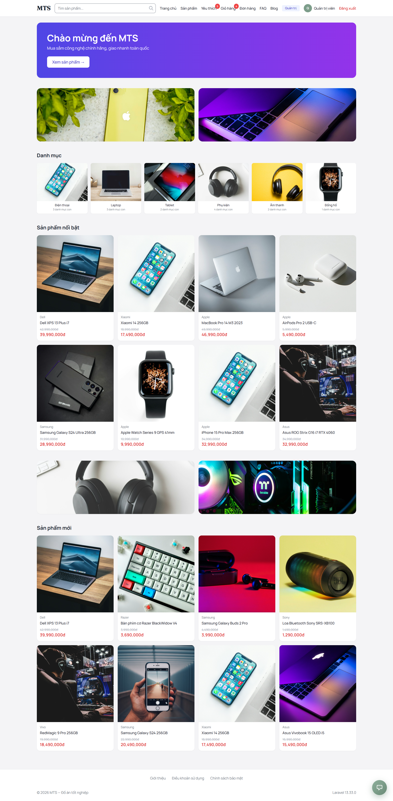
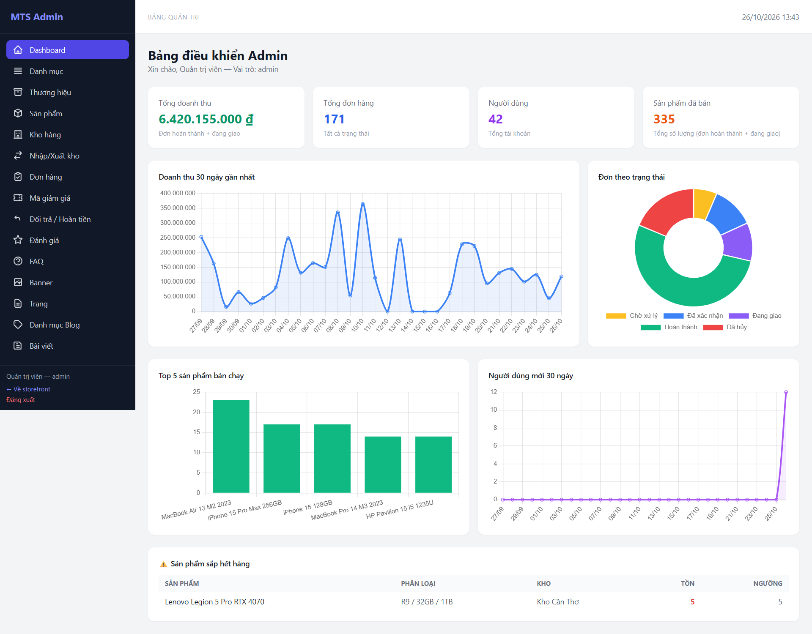

# MTS — Cửa hàng công nghệ

Website thương mại điện tử B2C xây dựng bằng Laravel. Dự án phục vụ học tập và portfolio, mô phỏng hoạt động của một cửa hàng bán thiết bị công nghệ.

## Tính năng

### Cửa hàng

- Tìm kiếm, lọc và sắp xếp sản phẩm theo danh mục, thương hiệu, giá và mức độ bán chạy.
- Trang chi tiết sản phẩm với hình ảnh, biến thể, khuyến mãi, đánh giá và sản phẩm liên quan.
- Giỏ hàng cho khách và người dùng đã đăng nhập; giỏ khách được gộp khi đăng nhập.
- Checkout với mã giảm giá, khu vực giao hàng, phương thức vận chuyển và thanh toán COD hoặc VNPay.
- Theo dõi, hủy đơn đủ điều kiện, tải hóa đơn và gửi yêu cầu trả hàng.
- Đánh giá sản phẩm sau khi đơn hoàn thành; danh sách yêu thích và thông báo khi có hàng.
- Trang tĩnh, FAQ, blog và chatbot tư vấn sản phẩm.

### Quản trị

- Dashboard doanh thu, đơn hàng, khách hàng, sản phẩm bán chạy và hàng sắp hết.
- Quản lý sản phẩm, biến thể, danh mục, thương hiệu và ảnh.
- Quản lý thuộc tính sản phẩm như màu sắc, kích cỡ; tạo biến thể theo giá trị thuộc tính và thêm ảnh riêng cho từng biến thể.
- Quản lý nhiều kho, nhập/xuất/điều chỉnh số lượng và lịch sử biến động tồn.
- Xử lý đơn hàng, chọn kho khi chuyển đơn sang giao hàng, quản lý thanh toán và đổi trả.
- Quản lý mã giảm giá có thể giới hạn theo danh mục, thương hiệu hoặc sản phẩm; quản lý đánh giá, banner, FAQ, trang tĩnh và nội dung blog.
- Phân quyền `admin`, `staff` và `customer`.

## Công nghệ

- PHP 8.3 trở lên, Laravel 13
- MySQL 8 hoặc SQLite
- Blade, Tailwind CSS, Alpine.js, Vite
- Laravel Breeze, Spatie Laravel Permission
- PHPUnit
- Tích hợp tùy chọn: VNPay Sandbox, Groq API, SMTP

## Tồn kho và trạng thái đơn

- Khi khách đặt hàng, hệ thống chưa trừ tồn. Khách vẫn có thể đặt số lượng vượt tồn kho.
- Admin chọn kho khi chuyển đơn sang `shipping`; hệ thống kiểm tra và trừ tồn tại bước này. Nếu kho không đủ, đơn không được chuyển sang giao hàng.
- Hủy đơn hoặc hoàn trả được xử lý theo lịch sử xuất kho để cập nhật tồn.
- `product_variants.stock` lưu tổng tồn được đồng bộ từ `inventories.quantity`.
- `products.rating_avg` và `products.rating_count` là dữ liệu tổng hợp từ đánh giá đang hiển thị.
- `order_items.product_name`, `sku` và `unit_price` lưu snapshot tại thời điểm đặt hàng.

Các trạng thái đơn đang dùng:

- `orders.status`: `pending`, `confirmed`, `shipping`, `completed`, `cancelled`.
- `orders.payment_status`: `unpaid`, `paid`, `refunded`.

Kho được liên kết với giao dịch qua `stock_movements.warehouse_id`; đơn hàng không lưu trực tiếp `warehouse_id`.

## Cài đặt

### Chạy trực tiếp

Cần cài PHP, Composer, Node.js và một database MySQL hoặc SQLite.

```bash
composer install
cp .env.example .env
php artisan key:generate
npm install
```

`.env.example` được cấu hình cho MySQL trong Laravel Sail. Nếu dùng MySQL cài trực tiếp, cập nhật `DB_HOST`, `DB_PORT`, `DB_DATABASE`, `DB_USERNAME` và `DB_PASSWORD` theo máy của bạn.

Để dùng SQLite, tạo file database và cập nhật `.env`:

```bash
touch database/database.sqlite
```

```dotenv
DB_CONNECTION=sqlite
DB_DATABASE=/đường/dẫn/tuyệt/đối/tới/dự-án/database/database.sqlite
```

Tạo bảng, dữ liệu mẫu và liên kết thư mục lưu ảnh:

```bash
php artisan migrate --seed
php artisan storage:link
npm run build
```

Chạy ứng dụng:

```bash
php artisan serve
```

Mở `http://127.0.0.1:8000`. Khi phát triển frontend, chạy `npm run dev` ở terminal riêng thay cho `npm run build`.

### Chạy bằng Laravel Sail

Cần Docker. Sau khi cài dependencies và tạo file `.env`:

```bash
composer install
cp .env.example .env
./vendor/bin/sail up -d
./vendor/bin/sail artisan key:generate
./vendor/bin/sail artisan migrate --seed
./vendor/bin/sail artisan storage:link
./vendor/bin/sail npm install
./vendor/bin/sail npm run dev
```

Mở `http://localhost`. Cấu hình trong `.env.example` dùng MySQL của Sail (`DB_HOST=mysql`).

## Cấu hình dịch vụ

Các tích hợp sau là tùy chọn:

| Biến | Mục đích |
| --- | --- |
| `APP_URL` | URL gốc của ứng dụng, dùng để tạo liên kết và URL ảnh |
| `DB_CONNECTION`, `DB_*` | Kết nối database |
| `MAIL_MAILER`, `MAIL_HOST`, `MAIL_PORT`, `MAIL_USERNAME`, `MAIL_PASSWORD`, `MAIL_FROM_ADDRESS` | Email thông báo |
| `GROQ_API_KEY` | Chatbot và chức năng tạo mô tả sản phẩm bằng AI |
| `VNPAY_TMN_CODE`, `VNPAY_HASH_SECRET`, `VNPAY_URL`, `VNPAY_RETURN_URL`, `VNPAY_IPN_URL` | Thanh toán VNPay |
| `FILESYSTEM_DISK` | Disk lưu file; ảnh sản phẩm được phục vụ từ disk `public` |

VNPay cần cấu hình URL return/IPN phù hợp với môi trường. Khi chạy local, dùng tunnel có thể truy cập từ bên ngoài nếu cần kiểm thử IPN. Khi dùng Sail, Mailpit nhận email tại `http://localhost:8025`.

Không đưa `.env` hoặc khóa API lên Git. Không dùng tài khoản và mật khẩu demo trên môi trường thật.

## Dữ liệu demo

`php artisan db:seed` chạy `DatabaseSeeder`, tạo vai trò, tài khoản mẫu, danh mục, thương hiệu, sản phẩm, biến thể, ảnh, tồn kho, đơn hàng, đánh giá, đổi trả và nội dung mẫu.

Tài khoản quản trị mặc định:

| Email | Mật khẩu | Vai trò |
| --- | --- | --- |
| `admin@example.com` | `password` | Admin |
| `staff@example.com` | `password` | Staff |
| `customer1@demo.local` … `customer30@demo.local` | `password` | Customer |

Chỉ sử dụng tài khoản này cho môi trường development/demo. `php artisan db:seed` có thể thêm dữ liệu giao dịch mới khi chạy lại; kiểm tra dữ liệu trước khi chạy trên database đang dùng.

Lệnh dọn dữ liệu demo:

```bash
php artisan demo:clean
```

Lệnh này xóa catalog, đơn hàng, tồn kho, giỏ hàng và danh sách yêu thích; giữ lại user, mã giảm giá và cấu hình giao hàng. Chỉ chạy trong môi trường development. Có thể thêm `--force` để bỏ bước xác nhận.

Để tạo biến thể mặc định cho sản phẩm đơn giản chưa có biến thể:

```bash
php artisan products:ensure-simple-variants
```

## Kiểm thử và định dạng

Test dùng SQLite in-memory theo cấu hình trong `phpunit.xml`; không cần tạo database test riêng.

```bash
php artisan test
```

Chạy một test file cụ thể:

```bash
php artisan test tests/Feature/Shop/CheckoutControllerTest.php
```

Định dạng các file PHP đã thay đổi:

```bash
vendor/bin/pint --dirty
```

## Cấu trúc chính

```text
app/
├── Console/Commands/     # Lệnh Artisan
├── Http/Controllers/     # Controller admin và cửa hàng
├── Http/Requests/        # Validation request
├── Models/               # Eloquent models
└── Services/             # Nghiệp vụ giỏ hàng, đơn hàng, kho, coupon, thanh toán

database/
├── factories/
├── migrations/
└── seeders/

resources/views/
├── admin/                # Giao diện quản trị
├── shop/                 # Giao diện cửa hàng
├── layouts/
└── components/

routes/                   # Route web, auth và console
tests/
├── Feature/
└── Unit/
```

## Ảnh giao diện




